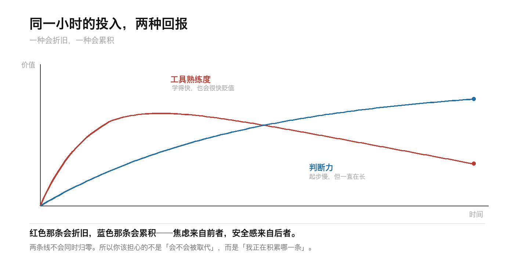

# AI 焦虑的真相：不是被取代，是「积累了也没用」

周三晚上十一点，你刷到一条推送：某个模型又更新了，某项能力超过了人类专家水平。

你点了收藏，关掉手机，心里发闷。

不是怕失业——你手头的工作还稳。是你突然意识到，自己已经连着几个月在下班后学新工具，却**说不清到底学到了什么**。

## 一、我们可能把焦虑的对象搞错了

这种情绪通常被叫做「AI 焦虑」，然后顺手归因成「怕被取代」。

如果真是这样，解法应该很清楚：学得更快、钻得更深、变成那个例外。

但试过的人都知道，这个方法不太管用。

原因在于，**「被取代」是一个结果判断，而你的焦虑是一种过程感受。**

结果判断可以等：行业什么时候变、岗位什么时候被重构，都有相对明确的时间尺度，你等得到信号。

过程感受不能等：它每天都在发生，每一条推送都在提醒你一次。

每天真正在响的其实是这句话：

> 我今天学的东西，半年后还值钱吗？

这句话背后不是恐惧，是**计算**。

## 二、算不过来的那一小时

过去学一门技术，投入产出是清楚的：一门语言能用很多年，一套方法论能撑住很长一段时间。

现在你不确定。可能是半年，可能是三个月，也可能下周就冒出一个新东西，把你刚熟练的做法变成「上一代方案」。

同样是一小时，**期望回报变了。**

人其实不怕辛苦，怕的是白辛苦。

这也解释了一个看着有点反直觉的现象：**用得越多的人，往往越焦虑。**

不用 AI 的同事反而很平静——他还没投入，自然没有沉没成本要算。而你已经投入了，所以开始计算回报率。

> [!WARNING] 别把这种焦虑当燃料
> 「焦虑驱动学习」在技能保鲜期长的年代是成立的，放到现在只是在加速消耗。
> 连续几个月用焦虑推着自己走，代价是：你不再愿意做任何短期看不到回报的事——而那类事，恰恰是积累判断力的。

## 三、问题可能出在「积累标的」上

多数人默认的积累标的是**工具能力**：会不会用某个模型、某个插件、某套工作流。

但工具能力正在被商品化。它越来越便宜、越来越标准化、越来越不需要专门去学。

那什么是没被商品化的？我看是三样：

**定义问题。** AI 很擅长答题，不擅长替你判断「该问什么」。练法：用 AI 之前，先写下你要解决的真实问题。

**验收结果。** AI 出错是常态，判断它错在哪，需要你真的懂这一行。练法：不直接采纳，逐条追问「这个结论的依据是什么」。

**承担责任。** 出事之后谁签字，这件事 AI 接不了。练法：主动认领结果，而不是把决定推给工具。

这三样有个共同点：**都不绑定具体工具，而且越用越厚。**

工具会换，判断不会。

## 四、三个问题，自测你的投入有没有复利

1. **今天学的东西，换一个工具还成立吗？** 成立，是积累；不成立，只是熟练度。
2. **有没有一件事，你比三个月前判断得更准了？** 有，你在长；没有，你在忙。
3. **如果明天出现一个更强的模型，你的价值会缩水多少？** 缩水很少，你积累的是判断；缩水很多，你积累的是操作。

三题不需要全过，但**至少得有一题让你有点底气**。一题都没有，那就是信号。

## 五、焦虑不会消失，但可以换一种

我不打算说「别焦虑」，这句话除了让人更焦虑之外没什么用。

我想说的是：**焦虑的对象是可以换的。**

「我会不会被取代」这个问题，你回答不了，也不该由你一个人回答。

「我今天有没有积累一件跟工具无关的东西」这个问题，你今天就能回答。

前一种焦虑没有终点，因为你永远等不到一个明确答案。
后一种焦虑每天都有答案，而且答案在你自己手里。

---

如果你最近也在为了「跟上」而学习，不妨留言说说：你上一次学到的东西，是什么时候被一个新工具变得不再必要的？

这可能比任何趋势预测都更能说明问题。
